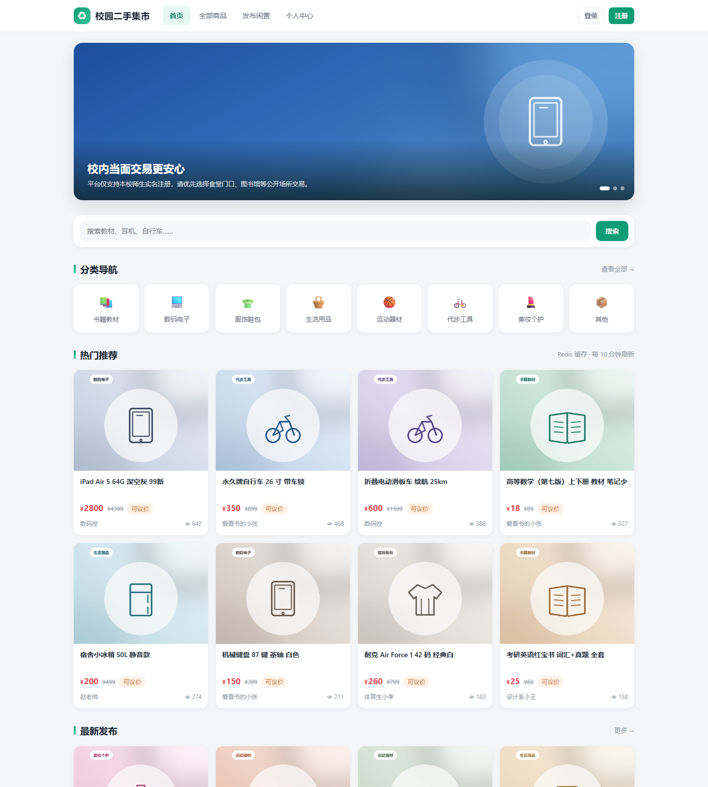
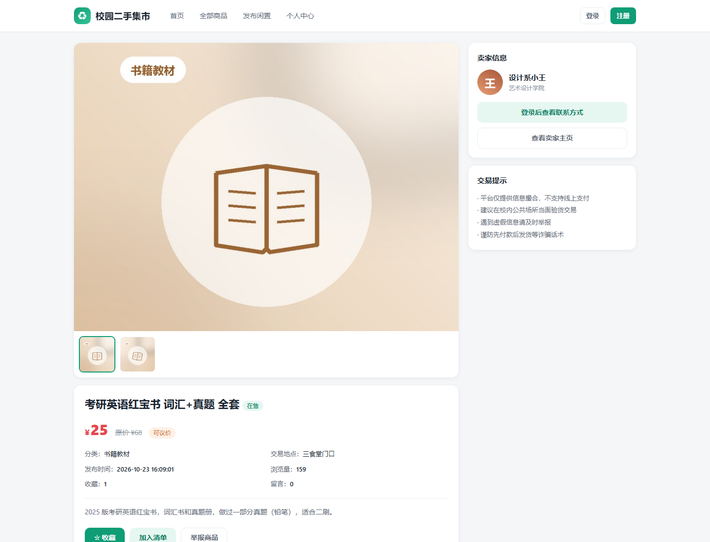
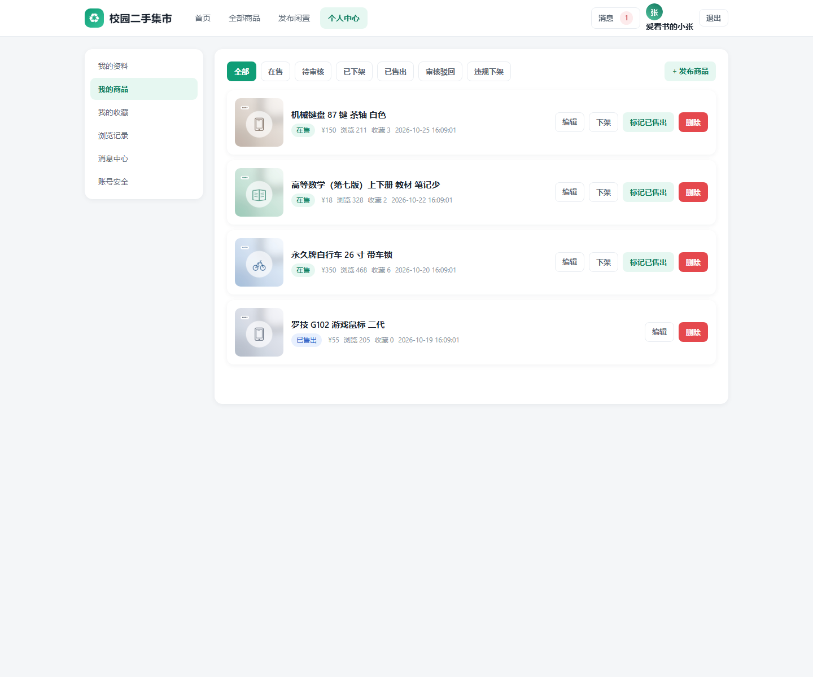
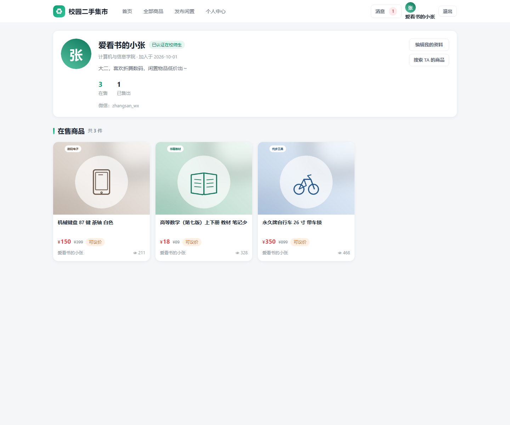
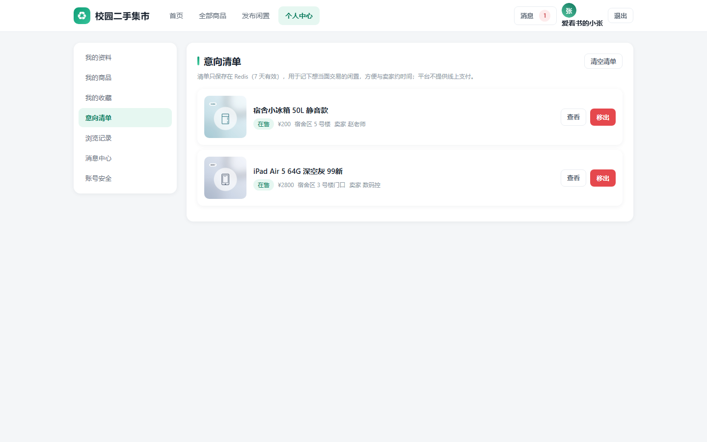
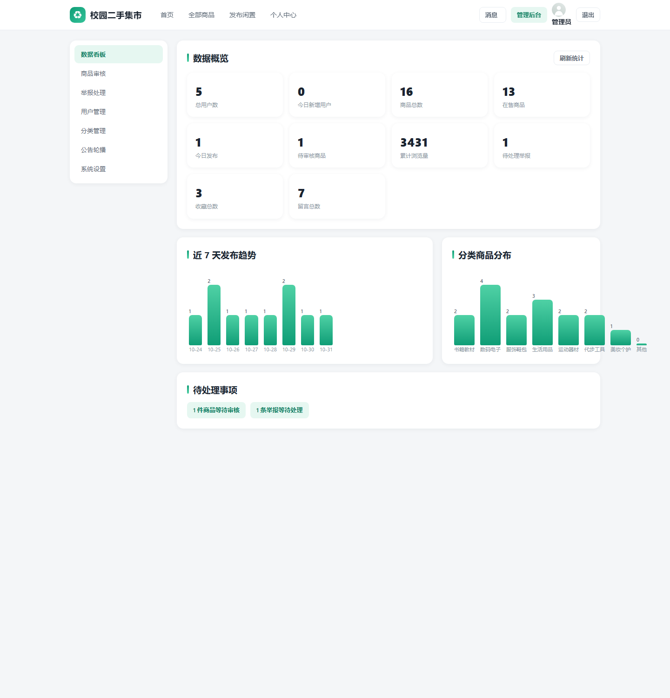

# 校园二手交易平台

一个面向**本校师生**的校内二手闲置交易平台：线上沟通、线下当面交易，平台只做信息撮合，**不做线上支付与资金担保**。

技术栈：**Spring Boot 3.5.16 + MyBatis-Plus 3.5.7 + MySQL 8 + Redis 5**；前端为原生 HTML / CSS / JavaScript 多页应用，由 Spring Boot 直接托管静态资源，无需单独构建或部署前端。

---

## 一、项目解决什么问题

高校里每年都会产生大量仍可使用的闲置物品——教材、考研资料、数码外设、衣服鞋子、球类、自行车。它们通常面临几个现实困难：

| 痛点 | 现状 | 本平台的做法 |
| --- | --- | --- |
| 二手交易平台不匹配校园场景 | 闲鱼、转转面向全社会，有平台服务费、需要快递物流，买家卖家往往不在同一城市 | 只服务本校，**交易地点固定在校内**（食堂门口、图书馆、宿舍区、体育馆等），当面验货交割，流程短 |
| 线上支付容易产生纠纷 | 先付款后发货的骗局在二手交易中常见 | **不涉及任何线上支付**，平台只提供信息与沟通渠道，钱货当面两清 |
| 校内群聊发布效率低 | 微信群、QQ 群消息刷屏，商品信息沉底，无法搜索、无分类、无价格排序 | 结构化发布（分类 / 原价 / 售价 / 是否可议价 / 交易地点 / 多图），支持关键词搜索、分类与价格区间筛选、四种排序 |
| 陌生人交易缺乏信任基础 | 不知道对方是不是本校的人 | 学号 / 工号实名注册，可开启**身份人工审核**；卖家资料、院系、在售商品可查 |
| 内容无人把关 | 群里的虚假信息、违规物品无人处理 | 商品可配置**发布审核**，买家可**举报**，管理员核实后下架 / 警告 / 封禁 |
| 热门数据把库压垮 | 首页热榜、商品浏览量属于高频读写 | 浏览量在 Redis 累加后定时落库；热榜、轮播、分类、看板全部走 Redis 缓存 |

**明确不做（设计边界）**：在线支付与资金担保、订单与物流、IM 实时聊天（用留言 + 站内信替代）、跨校交易。

---

## 二、主要功能

### 2.1 按角色

| 角色 | 能做什么 |
| --- | --- |
| 游客 | 浏览首页轮播与公告、8 个分类导航、热门推荐、最新发布；搜索 / 分类 / 价格区间 / 是否可议价筛选；按最新、价格升降、浏览量排序；查看商品详情、卖家主页、商家留言（联系方式需登录） |
| 普通用户（师生） | 注册（短信验证码）、登录、找回密码、改资料与头像、改密码、退出；发布 / 编辑 / 下架 / 重新上架 / 标记已售出 / 删除商品；收藏、意向清单、留言与回复、举报、浏览记录、消息中心 |
| 管理员 | 数据看板；商品审核（通过 / 驳回 / 强制下架 / 删除）；举报处理（下架商品 / 警告用户 / 封禁卖家 / 驳回举报）；用户管理（禁用 / 解封 / 身份审核）；分类管理；公告轮播管理；系统设置 |

### 2.2 按模块

| 模块 | 已实现的能力 |
| --- | --- |
| 注册登录 | 学号/工号 + 姓名 + 手机号 + 密码 + 短信验证码（Redis 5 分钟有效、60 秒内不可重发）；JWT + Redis **单点登录**（同账号只保留最新令牌）；退出、改密、被封禁均立即失效 |
| 首页 | 轮播图、平台公告、8 个分类、热门推荐（浏览量 + 收藏×3 + 留言×5 加权）、最新发布、搜索热词 |
| 商品 | 多图上传（界面最多 5 张、接口上限 9 张，单张 ≤5MB）、标题、描述、分类、原价、售价、是否可议价、校内交易地点；6 种状态流转 |
| 交易互动 | 收藏（计数同步）、意向清单（Redis，7 天过期）、两级留言与回复（自动通知）、联系卖家（微信 / 手机号按卖家意愿公开）、举报、浏览记录（保留最近 50 条） |
| 消息 | 商品被留言、留言被回复、审核结果、举报处理结果、系统通知；未读数、标记已读、全部已读、删除 |
| 管理后台 | 10 项指标看板 + 近 7 天发布趋势 + 分类分布图；商品审核；举报处理；用户禁用/解封与身份审核；分类与公告轮播 CRUD；5 项系统配置在线修改 |

### 2.3 商品状态

`0` 待审核 → `1` 在售 → `2` 已下架 / `3` 已售出，另有 `4` 审核驳回、`5` 违规下架。已售出商品不可再编辑或重新上架。

### 2.4 后台可在线修改的系统配置

| 配置项 | 默认值 | 作用 |
| --- | --- | --- |
| `product.audit.enabled` | `0` | 发布 / 编辑商品是否需要管理员审核 |
| `product.expire.days` | `30` | 商品上架多少天后自动下架（0 表示不限制） |
| `user.identity.check` | `1` | 新注册用户是否需要管理员审核身份后才能发布 |
| `platform.name` | 校园二手交易平台 | 平台名称 |
| `platform.notice` | 仅限本校师生使用… | 平台公告语 |

修改后 5 分钟内生效（配置有 5 分钟 Redis 缓存，保存时会主动清除）。

### 2.5 Redis 承担的工作

登录令牌、短信验证码与发送限流、商品浏览量增量、首页热门 / 轮播 / 分类缓存、收藏 ID 缓存、意向清单、数据看板缓存、搜索热词、接口限流计数。逐项 Key 与过期时间见[第八节](#八redis-使用说明)。

---

## 三、安装方法

### 3.1 环境要求

| 组件 | 版本 | 说明 |
| --- | --- | --- |
| JDK | 21 及以上 | 以 `release=21` 编译，已在 JDK 25 上构建、启动并通过接口测试 |
| Maven | 3.8 及以上 | 构建与依赖管理 |
| MySQL | 8.0 及以上 | 库名 `campus_trade` |
| Redis | 5.0 及以上 | 默认 `127.0.0.1:6379`、`db 0`、无密码 |

### 3.2 第一步：初始化数据库

```bash
# 建库 + 建表（会先 DROP DATABASE IF EXISTS campus_trade）
mysql -uroot -p --default-character-set=utf8mb4 -e "source src/main/resources/db/schema.sql"
# 导入演示数据
mysql -uroot -p --default-character-set=utf8mb4 -e "source src/main/resources/db/data.sql"
```

`data.sql` 包含：6 个账号、8 个分类、16 件商品（13 件在售，另有待审核 1 件、已下架 1 件、已售出 1 件）、5 条轮播与公告、7 条留言（含 2 条回复）、消息、1 条待处理举报、收藏、浏览记录与 5 项系统配置。

> **Windows PowerShell 注意**：不要用 `Get-Content xxx.sql | mysql`，管道会把 UTF-8 转成 GBK，报 `ERROR 1064 ... near '瀵嗙爜'`；请用上面的 `-e "source ..."` 写法，并尽量把 SQL 放到不含中文的路径下（`source` 对中文路径会报 `Failed to open file`）。

### 3.3 第二步：启动 Redis

```bash
redis-server                    # Linux / macOS
redis-server.exe redis.windows.conf   # Windows（下载 Redis-x64 后）
```

### 3.4 第三步：按需修改配置

配置文件：`src/main/resources/application.yml`

```yaml
server:
  port: 8080                      # 端口冲突时改这里

spring:
  datasource:
    url: jdbc:mysql://127.0.0.1:3306/campus_trade?useUnicode=true&characterEncoding=utf8&serverTimezone=Asia/Shanghai&useSSL=false&allowPublicKeyRetrieval=true
    username: ${DB_USERNAME:root}     # 环境变量 DB_USERNAME，未设置时用 root
    password: ${DB_PASSWORD:123456}   # 环境变量 DB_PASSWORD，未设置时用本地演示口令
  data:
    redis:
      host: 127.0.0.1
      port: 6379

campus:
  jwt:
    secret: ${CAMPUS_JWT_SECRET:}   # 环境变量 CAMPUS_JWT_SECRET（≥32 字节）；留空则每次启动随机生成
    expire-hours: 24
  upload:
    dir: ./uploads                # 图片保存目录（相对启动目录）
    url-prefix: /uploads          # 对外访问前缀
  product:
    audit-enabled: false          # 仅作初始默认，实际以数据库配置为准
    expire-days: 30
  sms:
    mock: true                    # 演示模式：验证码直接返回前端
```

> **仓库里不放真实凭据**：数据库口令与 JWT 密钥都通过环境变量注入。
> - 本地演示不设环境变量也能跑（用 `root / 123456`）。
> - 如果**不设** `CAMPUS_JWT_SECRET`，程序每次启动会随机生成密钥并打印一行 warning，效果是重启后需要重新登录一次——这比把固定密钥提交进仓库安全。
> - 正式部署务必设置：`export DB_PASSWORD='...'`、`export CAMPUS_JWT_SECRET='至少32字节的随机串'`（生成示例：`openssl rand -base64 48`）。

### 3.5 第四步：构建并运行

```bash
mvn -DskipTests package
java -jar target/campus-trade-0.1.0.jar
# 开发调试也可以直接：mvn spring-boot:run
```

看到下面这行即启动成功：

```
Tomcat started on port 8080 (http) with context path '/'
Started CampusTradeApplication in 3.4 seconds
```

随后访问 <http://localhost:8080/index.html>。也可以直接验证接口：

```bash
curl http://localhost:8080/api/home/overview
```

首次启动时 `PasswordInitializer` 会把 `t_user.password` 里的明文演示口令自动用 BCrypt 重新加密，并打印 `已将 6 个历史明文密码升级为 BCrypt 加密存储`——所以 `data.sql` 里存的是明文 `123456`，运行后库里就是 BCrypt 密文，两种状态都能正常登录。

### 3.6 演示账号

| 账号 | 密码 | 角色 | 说明 |
| --- | --- | --- | --- |
| `admin` | `123456` | 管理员 | 可进入 `admin.html` 后台 |
| `2021001` | `123456` | 学生 | 张三（爱看书的小张），3 件在售、1 件已售 |
| `2021002` | `123456` | 学生 | 李四（体育生小李） |
| `2021003` | `123456` | 学生 | 王五（设计系小王） |
| `2021004` | `123456` | 学生 | 孙七，身份**待审核**，用于演示身份审核 |
| `T2020001` | `123456` | 教师 | 赵老师 |

> 短信验证码是演示模式（`campus.sms.mock=true`）：注册 / 找回密码页点「获取验证码」后，验证码会直接显示在页面上（同时写入 Redis，5 分钟有效）。接入真实短信网关时关闭该开关即可。
>
> ⚠️ 这些是**公开的演示口令**，只适合本机/课堂使用。对外部署前请至少做一件事：用 `admin` 登录后到「账号安全」改掉管理员密码，或者直接删掉演示账号只保留自己的账号。

---

## 四、使用方法

### 4.1 页面入口

| 页面 | 地址 | 说明 |
| --- | --- | --- |
| 首页 | `/index.html` | 轮播、分类、热门推荐、最新发布、公告 |
| 商品列表 | `/products.html` | 搜索、筛选、排序、分页 |
| 商品详情 | `/product.html?id=1` | 图片、参数、卖家信息、留言、收藏、意向清单、举报 |
| 卖家主页 | `/seller.html?id=2` | 卖家资料与其在售商品 |
| 发布商品 | `/publish.html` | 新发布；带 `?id=` 为编辑 |
| 登录注册 | `/login.html` | 登录 / 注册 / 找回密码三个标签页 |
| 个人中心 | `/user.html` | `#profile` `#products` `#favorites` `#cart` `#history` `#messages` `#security` |
| 管理后台 | `/admin.html` | `#dashboard` `#products` `#reports` `#users` `#categories` `#notices` `#settings` |

### 4.2 游客：浏览与搜索

1. 打开首页，直接看到轮播、8 个分类、热门推荐 8 件与最新发布 8 件。
2. 搜索框输入关键词（匹配商品标题或描述）回车，跳到商品列表；搜索框下方的「热门搜索」来自 Redis 里真实的搜索计数（有人搜索过之后才出现）。
3. 列表页可组合条件：分类、最低价 / 最高价、是否可议价、排序（最新 / 价格升 / 价格降 / 浏览量）。
4. 点卡片进详情页：图片可切换、显示原价与售价、交易地点、浏览量、收藏数、留言数。
5. 未登录时卖家联系方式显示为「登录后查看联系方式」。

### 4.3 注册与登录

1. 登录页切到「注册」，填学号/工号、姓名、手机号、院系、密码，点「获取验证码」——演示模式下验证码会自动填好并提示。
2. 注册成功即进入登录态。默认开启了身份审核（`user.identity.check=1`），新账号身份为「待审核」，**此时不能发布商品**，需管理员在后台「用户管理 → 身份审核」通过。
3. 忘记密码：切到「找回密码」，手机号 + 验证码即可重置；重置后需重新登录。

### 4.4 买家：从看货到约见

1. **收藏**：详情页点「☆ 收藏」，在「个人中心 → 我的收藏」查看。
2. **意向清单**：详情页点「加入清单」，记录到「个人中心 → 意向清单」（只存 Redis，7 天有效），可逐条移出或清空。适合逛到时先记下、之后一起约卖家。
3. **留言咨询**：详情页底部输入框提问；卖家可在同页回复，回复会显示在留言下方；也能删除自己的留言。
4. **联系卖家**：卖家在「个人中心 → 我的资料」里设置「联系方式公开」后，详情页右侧会展示微信与手机号；关闭时只提示通过留言联系。
5. **举报**：详情页「举报商品」，选理由（虚假信息 / 违规物品 / 广告 / 色情低俗 / 其他）并补充说明；同一商品在管理员处理前不能重复举报，也不能举报自己的商品。
6. **浏览记录**：看过的商品会进入「个人中心 → 浏览记录」，最多保留 50 条。
7. **消息**：商品被留言、留言被回复都会收到站内消息，导航栏「消息」上有未读数红点。

### 4.5 卖家：发布与管理

1. 「发布闲置」填写标题、分类、交易地点（食堂门口 / 图书馆门口 / 宿舍区 / 教学楼 / 体育馆 / 校门口 / 其他）、售价、原价、是否可议价，上传最多 5 张图，写描述后提交。
2. 提交后的状态取决于「发布审核开关」：关闭则直接**在售**；开启则**待审核**，管理员通过后才可见。
3. 「个人中心 → 我的商品」按状态分 tab 管理：编辑、下架、标记已售出、重新上架、删除。已售出的商品不能再编辑或上架。
4. 商品默认 30 天有效，过期由定时任务自动下架；重新上架会重新计算有效期（审核开关打开时需再次审核）。

### 4.6 管理员：后台操作

用 `admin / 123456` 登录后进入「管理后台」，顶部导航出现「管理后台」入口。

| 区块 | 操作 |
| --- | --- |
| 数据看板 | 总用户、今日新增、商品总数、在售、今日发布、待审核、累计浏览量、待处理举报、收藏总数、留言总数；近 7 天发布趋势与分类分布图；「待处理事项」可一键跳转 |
| 商品审核 | 按状态 / 标题筛选；待审核商品可「通过」「驳回（填理由）」「强制下架（填理由）」「删除」 |
| 举报处理 | 查看举报人、卖家、理由与说明；处理方式：下架商品 / 警告用户 / 封禁卖家 / 驳回举报（都需填处理说明，并会自动通知相关用户） |
| 用户管理 | 账号、姓名/昵称、院系、脱敏手机号、身份、状态、在售/已售数；禁用或解封、身份审核（通过 / 不通过） |
| 分类管理 | 新增、编辑（名称/图标/排序/状态）、删除（分类下还有商品时不允许删除） |
| 公告轮播 | 新增 / 编辑 / 删除轮播图与公告，控制排序与上下线 |
| 系统设置 | 修改 2.4 节五个配置项，保存后立即清缓存 |

### 4.7 一场 5 分钟的演示路线

1. 游客打开首页 → 搜索「教材」→ 切换「价格从低到高」。
2. 进某个商品详情，点「加入清单」，再点「举报商品」随便选个理由提交。
3. 用 `admin` 登录 → 「数据看板」看到待审核数、待处理举报数变化 → 去「举报处理」驳回这条举报。
4. 用 `2021001` 登录 → 「发布闲置」发一件商品（审核开关关闭时会直接出现首页「最新发布」）。
5. 回到 `admin` → 「商品审核」把它强制下架；再用 `2021001` 看「我的商品」，状态变成「违规下架」。
6. 用 `2021004` 登录尝试发布，会提示身份待审核；`admin` 在「用户管理」通过身份审核后再试即可发布。

### 4.8 从其它设备访问

应用监听 `0.0.0.0:8080`，同一局域网内的手机 / 平板 / 另一台电脑可以直接访问 `http://<本机局域网IP>:8080/index.html`（Windows 需在防火墙放行 8080，或首次运行时允许 Java 访问网络）。

- 若打不开，先确认两台设备在同一网段，再确认路由器 / 校园网**没有开启 AP 隔离**（客户端隔离），必要时用手机热点组网。
- 多设备演示时请使用**不同账号**：系统是单点登录，同一账号后登录会挤掉前一个设备的登录态。
- 需要公网访问时属于额外部署工作（内网穿透或云服务器 + Nginx/HTTPS），详见[第十三节常见问题](#十三常见问题)。

---

## 五、输入输出示例

### 5.1 接口统一约定

所有接口都返回统一的 JSON 结构，**HTTP 状态码恒为 200**，业务结果由 `code` 表达：

```json
{ "code": 200, "message": "操作成功", "data": {} }
```

| `code` | 含义 | 典型场景 |
| --- | --- | --- |
| 200 | 成功 | 正常返回 |
| 400 | 参数或业务校验失败 | 验证码为空、密码太短、不能举报自己的商品、身份待审核 |
| 401 | 未登录 / 登录已失效 | 未带 token、token 过期、在别处登录被顶掉、账号被禁用 |
| 403 | 已登录但无权限 | 普通用户访问 `/api/admin/**` |
| 404 | 资源不存在 | 商品不存在或已被删除 |
| 429 | 请求过于频繁 | 触发接口限流（验证码、登录、发布、举报等） |
| 500 | 服务端异常 | 未预期错误，具体原因见运行日志 |

需要登录的接口带请求头：`Authorization: Bearer <token>`。分页统一返回 `records`、`total`、`page`、`size`、`pages`。

### 5.2 界面上的输入 → 输出

| 你在界面上的输入 | 看到的结果 |
| --- | --- |
| 搜索框输入 `教材` | 列表只显示标题或描述含「教材」的在售商品，顶部显示「共 N 件商品」 |
| 分类选「数码电子」+ 价格 100–500 + 排序「浏览量」 | 该分类下 100~500 元的商品按浏览量从高到低排列，URL 同步这些条件，可直接分享 |
| 详情页点「☆ 收藏」 | 按钮变成「★ 已收藏」，收藏数 +1，个人中心收藏列表出现该商品 |
| 详情页点「加入清单」 | 顶部提示「已加入意向清单，可在「个人中心 - 意向清单」查看」，个人中心意向清单出现该商品 |
| 提交留言 `这个还在吗？` | 留言出现在详情页底部；卖家收到站内消息，导航红点 +1 |
| 发布商品成功后 | 自动跳转到新商品详情页，「我的商品」出现该条记录（审核关闭为「在售」，开启为「待审核」） |
| 管理员点「驳回」并填理由 | 商品状态变「审核驳回」，卖家「我的商品」显示驳回理由，并收到审核消息 |

### 5.3 登录：`POST /api/auth/login`

```bash
curl -X POST http://localhost:8080/api/auth/login \
  -H "Content-Type: application/json" \
  -d '{"account":"2021001","password":"123456"}'
```

```json
{
  "code": 200,
  "message": "登录成功",
  "data": {
    "token": "eyJhbGciOiJIUzI1NiJ9.eyJzdWIiOiIyIiwi…省略…KAbc123",
    "expireSeconds": 86400,
    "user": {
      "id": 2,
      "account": "2021001",
      "name": "张三",
      "nickname": "爱看书的小张",
      "avatar": "/images/avatar/1.png",
      "department": "计算机与信息学院",
      "intro": "大二，喜欢折腾数码，闲置物品低价出～",
      "role": "USER",
      "status": 0,
      "identityStatus": 1,
      "wechat": "zhangsan_wx",
      "phone": "138****0001",
      "contactPublic": 1,
      "createTime": "2026-10-01 16:09:01",
      "onSaleCount": 3,
      "soldCount": 1
    }
  }
}
```

说明：`phone` 是脱敏手机号（前 3 位 + `****` + 后 4 位）；密码错误与账号不存在统一返回 `{"code":400,"message":"账号或密码错误"}`；被禁用账号返回 `{"code":400,"message":"账号已被禁用，请联系管理员"}`。

### 5.4 搜索商品：`GET /api/products`

```bash
# 关键词 + 分类 + 价格区间 + 是否可议价 + 排序 + 分页
curl "http://localhost:8080/api/products?keyword=教材&categoryId=1&minPrice=10&maxPrice=100&negotiable=1&sort=priceAsc&page=1&size=12"
```

| 参数 | 说明 |
| --- | --- |
| `keyword` | 匹配标题或描述，可空 |
| `categoryId` | 分类 ID，可空 |
| `minPrice` / `maxPrice` | 价格区间，可空 |
| `negotiable` | `1` 只看可议价，`0` 只看不议价，空为全部 |
| `sort` | `new`（默认，最新）/ `priceAsc` / `priceDesc` / `hot`（浏览量） |
| `page` / `size` | 页码从 1 开始；`size` 上限 60，默认 12 |

结果只包含**在售**商品，响应（节选）：

```json
{
  "code": 200,
  "message": "操作成功",
  "data": {
    "records": [
      {
        "id": 1,
        "userId": 2,
        "sellerName": "爱看书的小张",
        "sellerAvatar": "/images/avatar/1.png",
        "sellerDepartment": "计算机与信息学院",
        "categoryId": 1,
        "categoryName": "书籍教材",
        "title": "高等数学（第七版）上下册 教材 笔记少",
        "description": "大一高数教材，同济第七版上下册，只有少量勾画，无缺页。…",
        "originalPrice": 89.00,
        "price": 18.00,
        "negotiable": 1,
        "tradePlace": "图书馆一楼大厅",
        "cover": "/images/products/p1.jpg",
        "images": ["/images/products/p1.jpg", "/images/products/p1b.jpg"],
        "status": 1,
        "statusText": "在售",
        "rejectReason": null,
        "viewCount": 329,
        "favoriteCount": 2,
        "commentCount": 3,
        "publishTime": "2026-10-22 16:09:01",
        "expireTime": "2026-11-21 16:09:01",
        "createTime": "2026-10-22 16:09:01",
        "favorited": false,
        "owner": false,
        "wechat": "zhangsan_wx",
        "sellerPhone": "13800000001"
      }
    ],
    "total": 2,
    "page": 1,
    "size": 12,
    "pages": 1
  }
}
```

字段含义：`status` / `statusText` 为商品状态与中文文案；`favorited` 表示当前登录用户是否已收藏；`owner` 表示是否本人发布；`wechat`、`sellerPhone` 仅在卖家**公开联系方式**时才有值（列表与详情都遵循该规则，脱敏只作用于后台用户信息列表）。

### 5.5 商品详情：`GET /api/products/{id}`

```bash
curl "http://localhost:8080/api/products/1" -H "Authorization: Bearer <token>"
```

与列表单条结构相同，另外：每次访问会把浏览量 +1（写 Redis，2 分钟内批量落库），登录用户还会写入浏览记录。非在售商品对非本人、非管理员不可见，商品不存在或已删除返回：

```json
{ "code": 404, "message": "商品不存在或已被删除", "data": null }
// 已存在但不是「在售」状态
{ "code": 404, "message": "商品已下架或已售出", "data": null }
```

### 5.6 发布商品：`POST /api/products`（需登录）

```bash
curl -X POST http://localhost:8080/api/products \
  -H "Authorization: Bearer <token>" -H "Content-Type: application/json" \
  -d '{
    "title": "二手篮球鞋 42 码",
    "description": "穿过一学期，鞋底磨损轻微，适合打球。",
    "categoryId": 5,
    "price": 120,
    "originalPrice": 499,
    "negotiable": 1,
    "tradePlace": "体育馆门口",
    "images": ["/images/products/p9.jpg"]
  }'
```

```json
{ "code": 200, "message": "发布成功", "data": 20 }
```

`data` 即新商品 ID（示例值，实际随发布递增）。注意 `negotiable` 是**整数**（`1` 可议价 / `0` 不议价），传布尔值 `true` 会得到 `{"code":400,"message":"请求参数格式错误"}`。

失败示例：

```json
// 身份待审核
{ "code": 400, "message": "您的身份正在审核中，暂时无法发布商品", "data": null }
// 发布过于频繁（限流 10 次 / 300 秒）
{ "code": 429, "message": "发布过于频繁，请稍后再试", "data": null }
```

### 5.7 收藏：`POST /api/favorites/{productId}/toggle`（需登录）

```json
{ "code": 200, "message": "收藏成功",   "data": { "favorited": true } }
{ "code": 200, "message": "已取消收藏", "data": { "favorited": false } }
```

同一个接口切换状态，`data.favorited` 为切换后的结果；查询状态用 `GET /api/favorites/1/check`，未登录时返回 `{"code":200,"data":{"favorited":false}}`。

### 5.8 意向清单：`/api/cart`（需登录）

```bash
curl -X POST http://localhost:8080/api/cart/9 -H "Authorization: Bearer <token>"
```

```json
{ "code": 200, "message": "已加入意向清单", "data": { "count": 1 } }
```

读取清单（`GET /api/cart`）：

```json
{
  "code": 200,
  "message": "操作成功",
  "data": {
    "items": [ { "id": 9, "title": "斯伯丁 7 号篮球 室内外通用", "price": 60.00, "tradePlace": "篮球场", "statusText": "在售", "…": "其余字段同上" } ],
    "count": 1
  }
}
```

移出 `DELETE /api/cart/{productId}`、清空 `DELETE /api/cart` 都返回最新 `count`。

### 5.9 留言（两级）：`GET /api/products/11/comments`

```json
{
  "code": 200,
  "message": "操作成功",
  "data": [
    {
      "id": 6,
      "productId": 11,
      "userId": 6,
      "nickname": "数码控",
      "avatar": "/images/avatar/5.png",
      "content": "车锁是原装的吗？刹车是碟刹还是 V 刹？",
      "parentId": 0,
      "replyUserId": null,
      "replyNickname": null,
      "createTime": "2026-10-28 16:09:01",
      "replies": [
        {
          "id": 7,
          "productId": 11,
          "userId": 2,
          "nickname": "爱看书的小张",
          "avatar": "/images/avatar/1.png",
          "content": "锁是后配的 U 型锁，前轮 V 刹后轮也是 V 刹，刚换过刹车皮。",
          "parentId": 6,
          "replyUserId": 6,
          "replyNickname": "数码控",
          "createTime": "2026-10-28 16:09:01",
          "replies": null
        }
      ]
    }
  ]
}
```

发布留言 / 回复（`POST /api/products/{productId}/comments`，需登录）：

```bash
curl -X POST http://localhost:8080/api/products/9/comments \
  -H "Authorization: Bearer <token>" -H "Content-Type: application/json" \
  -d '{"content":"这个篮球还在吗？想明天下午球场看下。","parentId":0}'
```

```json
{
  "code": 200,
  "message": "留言成功",
  "data": {
    "id": 9,
    "productId": 9,
    "userId": 4,
    "nickname": "设计系小王",
    "avatar": "/images/avatar/3.png",
    "content": "这个篮球还在吗？想明天下午球场看下。",
    "parentId": 0,
    "replyUserId": null,
    "replyNickname": null,
    "createTime": "2026-10-31 20:13:04",
    "replies": null
  }
}
```

回复某人时把 `parentId` 设为对方留言的 `id`，系统会自动填充 `replyUserId`，并给对方发一条 `REPLY` 消息。

### 5.10 消息列表：`GET /api/messages?page=1&size=10`（需登录）

```json
{
  "code": 200,
  "message": "操作成功",
  "data": {
    "records": [
      {
        "id": 4,
        "type": "COMMENT",
        "typeText": "商品留言",
        "title": "你的商品收到新留言",
        "content": "设计系小王 留言：冰箱能帮忙搬到楼下吗？",
        "relatedId": 7,
        "isRead": 0,
        "createTime": "2026-10-27 16:09:01"
      }
    ],
    "total": 1,
    "page": 1,
    "size": 10,
    "pages": 1
  }
}
```

`type` 取值与文案：`COMMENT` 商品留言、`REPLY` 留言回复、`AUDIT` 审核结果、`REPORT` 举报处理、`SYSTEM` 系统通知；`relatedId` 为关联商品 ID。未读数用 `GET /api/messages/unread-count` → `{"code":200,"data":1}`。

### 5.11 上传图片：`POST /api/upload/image`（需登录，multipart）

```bash
curl -X POST http://localhost:8080/api/upload/image \
  -H "Authorization: Bearer <token>" \
  -F "file=@/path/to/photo.png;type=image/png"
```

```json
{ "code": 200, "message": "上传成功", "data": { "url": "/uploads/202610/21f3d846ea2846bab6e59010aa655b6c.png" } }
```

限制：仅 `jpg/jpeg/png/gif/webp`，单张 ≤5MB，Content-Type 需为 `image/*`；超出返回 `{"code":400,"message":"图片大小不能超过 5MB"}`。返回的 `url` 可直接作为发布商品的 `images` 元素。

### 5.12 管理端：审核商品 `PUT /api/admin/products/{id}/audit`（需管理员）

```bash
curl -X PUT http://localhost:8080/api/admin/products/15/audit \
  -H "Authorization: Bearer <管理员token>" -H "Content-Type: application/json" \
  -d '{"pass":true,"reason":""}'
```

```json
{ "code": 200, "message": "审核完成", "data": null }
```

驳回时传 `{"pass":false,"reason":"图片与描述不符"}`，商品变为「审核驳回」并给卖家发审核消息。数据看板 `GET /api/admin/stats` 返回：

```json
{
  "code": 200,
  "message": "操作成功",
  "data": {
    "totalUsers": 5,
    "todayUsers": 0,
    "totalProducts": 16,
    "onSaleProducts": 13,
    "todayProducts": 1,
    "pendingProducts": 1,
    "totalViews": 3435,
    "pendingReports": 1,
    "totalFavorites": 3,
    "totalComments": 7,
    "categoryStat": [ { "name": "书籍教材", "value": 2 }, { "name": "数码电子", "value": 4 } ],
    "publishTrend": [ { "name": "10-25", "value": 1 } ],
    "userTrend": [ { "name": "10-25", "value": 0 } ]
  }
}
```

（以上数值来自演示数据，会随操作变化；`totalUsers` 只统计普通用户，不含管理员。）

### 5.13 错误响应示例

```json
// 401：未登录或令牌失效
{ "code": 401, "message": "登录已失效，请重新登录", "data": null }

// 403：普通用户访问后台
{ "code": 403, "message": "无权访问该功能", "data": null }

// 400：参数校验失败
{ "code": 400, "message": "密码长度为 6-20 位", "data": null }

// 400：业务规则拒绝
{ "code": 400, "message": "不能举报自己发布的商品", "data": null }

// 404：资源不存在
{ "code": 404, "message": "商品不存在", "data": null }

// 429：触发限流（验证码 5 次/300 秒、登录 20 次/300 秒、注册 10 次/600 秒、发布 10 次/300 秒、举报 10 次/600 秒）
{ "code": 429, "message": "验证码请求过于频繁，请稍后再试", "data": null }
```

---

## 六、项目结构

```
campus-trade/
├── pom.xml
├── README.md
├── docs/screenshots/                    # README 中引用的界面截图
├── src/main/java/com/campus/trade/
│   ├── CampusTradeApplication.java      # 启动类（@EnableScheduling / @MapperScan）
│   ├── common/                          # Result、PageResult、BizException、UserContext、RedisKeys、ProductStatus
│   ├── config/                          # Web（拦截器/CORS/静态资源）、MyBatis-Plus、Jackson、BCrypt、平台配置、明文密码升级
│   ├── security/                        # JwtUtil、@LoginRequired、AuthInterceptor
│   ├── ratelimit/                       # @RateLimit 注解与 Redis INCR 切面
│   ├── entity/ mapper/ dto/ vo/         # 11 张表的实体与 Mapper、请求 DTO、响应 VO
│   ├── service/                         # Auth/User/Product/Category/Notice/Home/Favorite/Cart/BrowseHistory/Comment/Message/Report/File/Stat/Config
│   ├── controller/                      # REST 接口（Auth/Home/Product/User/Favorite/Cart/Comment/Message/Report/Upload/Admin）
│   └── task/SchedulerTasks.java         # 浏览量落库、热门刷新、过期下架
└── src/main/resources/
    ├── application.yml
    ├── db/schema.sql  db/data.sql
    └── static/                          # 前端 8 个页面 + css/js/images
        ├── index.html products.html product.html seller.html
        ├── publish.html login.html user.html admin.html
        ├── css/style.css  js/api.js  js/common.js
        └── images/{banner,products,avatar}/
```

## 七、数据库设计

库名 `campus_trade`，共 11 张表：

| 表 | 作用 | 关键字段 |
| --- | --- | --- |
| `t_user` | 用户 | `account`（学号/工号）、`name`、`phone`、`password`(BCrypt)、`nickname`、`avatar`、`department`、`intro`、`wechat`、`contact_public`、`role`（ADMIN/USER）、`status`（0 正常 1 禁用）、`identity_status`（0 待审核 1 已认证 2 未通过） |
| `t_category` | 分类 | `name`、`icon`、`sort`、`status` |
| `t_product` | 商品 | `title`、`description`、`category_id`、`price`、`original_price`、`negotiable`、`trade_place`、`cover`、`status`、`reject_reason`、`view_count`、`favorite_count`、`comment_count`、`publish_time`、`expire_time`、`deleted` |
| `t_product_image` | 商品图片 | `product_id`、`url`、`sort` |
| `t_favorite` | 收藏 | `user_id`、`product_id` |
| `t_comment` | 留言 | `product_id`、`user_id`、`parent_id`（0 为顶级）、`reply_user_id`、`content` |
| `t_message` | 站内消息 | `user_id`、`type`、`title`、`content`、`related_id`、`is_read` |
| `t_report` | 举报 | `product_id`、`reporter_id`、`reason`、`description`、`status`（0 待处理 1 已处理 2 已驳回）、`handler_id`、`handle_remark` |
| `t_notice` | 轮播与公告 | `title`、`content`、`image`、`type`（0 轮播 1 公告）、`sort`、`status` |
| `t_browse_history` | 浏览记录 | `user_id`、`product_id`、`view_time` |
| `t_sys_config` | 系统配置 | `config_key`、`config_value`、`remark` |

`t_user`、`t_category`、`t_product`、`t_comment`、`t_message`、`t_notice`、`t_report` 使用逻辑删除（`deleted` 字段，MyBatis-Plus 自动过滤），删除后数据保留但不再展示。

## 八、Redis 使用说明

| Key | 类型 | 用途 | 过期 |
| --- | --- | --- | --- |
| `login:token:{userId}` | String | 登录令牌（单点登录；退出/改密/禁用即删） | 与 JWT 一致（24h） |
| `sms:code:{phone}` | String | 短信验证码 | 5 分钟 |
| `sms:limit:{phone}` | String | 验证码发送频率限制 | 60 秒 |
| `product:view:delta` | Hash | 浏览量增量，定时批量落库 | — |
| `home:hot:list` | String | 热门推荐列表缓存（JSON） | 10 分钟 |
| `home:banners` / `home:categories` | String | 轮播图、分类导航缓存 | 30 分钟 |
| `favorite:ids:{userId}` | String | 用户收藏 ID 缓存 | 30 分钟（收藏变更即删） |
| `cart:{userId}` | Hash | 意向清单（productId → 加入时间） | 7 天 |
| `stat:overview` | String | 数据看板缓存 | 60 秒 |
| `search:hot` | ZSet | 搜索热词排行 | — |
| `rate:{scope}:{identity}` | String | 接口限流计数（按用户，未登录按 IP） | 按注解配置 |

## 九、完整接口清单

除标注外均返回 5.1 的统一结构。

### 认证 `/api/auth`

| 方法 | 路径 | 鉴权 | 说明 |
| --- | --- | --- | --- |
| POST | `/sms-code` | 否 | 发送验证码（限流 5 次/300 秒）→ `{phone, expireSeconds, code, mock}` |
| POST | `/register` | 否 | 注册（限流 10 次/600 秒）→ 登录信息 |
| POST | `/login` | 否 | 登录（限流 20 次/300 秒） |
| POST | `/logout` | 是 | 退出，删除 Redis 令牌 |
| POST | `/reset-password` | 否 | 手机号 + 验证码重置密码 |

### 首页 `/api/home`（公开）

`GET /overview`（`banners`/`categories`/`hot`/`latest`/`notices`）、`GET /banners`、`GET /categories`、`GET /hot?limit=8`、`GET /latest?limit=8`、`GET /notices`、`GET /keywords?limit=8`。

### 商品 `/api/products`

| 方法 | 路径 | 鉴权 | 说明 |
| --- | --- | --- | --- |
| GET | `` | 否 | 搜索/筛选/排序（见 5.4） |
| GET | `/hot?limit=8` | 否 | 热门商品 |
| GET | `/mine?status=&page=&size=` | 是 | 我的商品 |
| GET | `/{id}` | 否 | 详情（浏览量 +1，记录浏览） |
| POST | `` | 是 | 发布（限流 10 次/300 秒） |
| PUT | `/{id}` | 是 | 编辑 |
| PUT | `/{id}/status` | 是 | `{"status":1/2/3}` 上架 / 下架 / 已售出 |
| DELETE | `/{id}` | 是 | 删除 |
| GET | `/seller/{sellerId}` | 否 | 卖家在售商品 |

### 用户 `/api/user`（需登录）

`GET /me`、`PUT /profile`、`PUT /password`、`GET /favorites?page=&size=`、`GET /history?page=&size=`、`DELETE /history`、`GET /{id}`（卖家主页）、`GET /{id}/products`。

### 收藏 / 清单 / 留言 / 消息 / 举报 / 上传

| 方法 | 路径 | 鉴权 | 说明 |
| --- | --- | --- | --- |
| POST | `/api/favorites/{productId}/toggle` | 是 | 收藏 / 取消收藏 |
| GET | `/api/favorites/{productId}/check` | 否 | 是否已收藏，返回 `{"favorited":false}`（未登录恒为 `false`） |
| GET | `/api/cart` | 是 | 意向清单 |
| GET | `/api/cart/count` | 是 | 清单数量 |
| POST | `/api/cart/{productId}` | 是 | 加入 |
| DELETE | `/api/cart/{productId}` | 是 | 移出 |
| DELETE | `/api/cart` | 是 | 清空 |
| GET | `/api/products/{productId}/comments` | 否 | 两级留言 |
| POST | `/api/products/{productId}/comments` | 是 | 留言 / 回复 |
| DELETE | `/api/comments/{id}` | 是 | 删除自己的留言（管理员可删任意） |
| GET | `/api/messages?isRead=&page=&size=` | 是 | 消息列表 |
| GET | `/api/messages/unread-count` | 是 | 未读数 |
| PUT | `/api/messages/{id}/read`、`/api/messages/read-all` | 是 | 标记已读 |
| DELETE | `/api/messages/{id}` | 是 | 删除消息 |
| POST | `/api/products/{productId}/reports` | 是 | 举报（限流 10 次/600 秒） |
| POST | `/api/upload/image` | 是 | 上传图片（≤5MB） |

### 管理后台 `/api/admin`（需管理员，类级 `@LoginRequired(admin=true)`）

- 用户：`GET /users`、`GET /users/{id}`、`PUT /users/{id}/status`（`{"status":0|1}` 解封/禁用）、`PUT /users/{id}/identity`（`{"status":1|2,"remark":""}`）
- 商品：`GET /products`、`PUT /products/{id}/audit`、`PUT /products/{id}/offline?reason=`、`DELETE /products/{id}`
- 举报：`GET /reports`、`PUT /reports/{id}/handle`（`{"action":"offline|warn|ban|reject","remark":""}`）
- 分类：`GET|POST /categories`、`PUT|DELETE /categories/{id}`
- 公告：`GET /notices?type=`、`POST /notices`、`PUT|DELETE /notices/{id}`
- 统计：`GET /stats`、`PUT /stats/refresh`
- 配置：`GET /configs`、`PUT /configs`（`{"configKey":"…","configValue":"…"}`）

## 十、关键设计说明

1. **鉴权**：登录签发 JWT 并把同一份令牌写入 `login:token:{userId}`；拦截器同时校验签名与 Redis 中的令牌是否一致，因此支持单点登录、退出即失效、封禁立即踢下线。
2. **权限**：`@LoginRequired`（可 `admin = true`）标注在类或方法上，拦截器统一返回 401 / 403；业务代码通过 `UserContext` 取当前用户。未标注的公开接口也会尝试解析令牌，用于返回 `favorited`、`owner` 等个性化字段。
3. **限流**：`@RateLimit(key, count, seconds, message)` + Redis `INCR` + 首次设置过期时间，已登录按用户 ID 计数、未登录按 IP 计数，超限返回 429。
4. **浏览量**：详情页 `HINCRBY product:view:delta`，定时任务每 2 分钟把增量累加进 `t_product.view_count` 并删除 field；接口返回「库中值 + 未落库增量」。
5. **热门推荐**：`浏览量 + 收藏×3 + 留言×5` 加权取前 N，结果缓存 10 分钟；商品发布、下架、审核、删除等操作会主动清缓存。
6. **审核开关**：`product.audit.enabled` 开启时发布与编辑都进入待审核，通过后才上架；驳回需填理由并通知卖家。
7. **身份校验**：`user.identity.check` 开启时新注册用户 `identity_status=0`，未通过前发布接口直接拒绝；管理员审核后变为已认证。
8. **过期下架**：发布/上架时按 `product.expire.days` 写 `expire_time`，定时任务每天 03:00 把过期商品置为已下架。
9. **图片上传**：保存到 `campus.upload.dir` 下的 `yyyyMM/` 目录，通过 `/uploads/**` 映射访问；演示图片放在 `static/images`。
10. **存储分层**：业务数据全部落 MySQL；高频计数、令牌、验证码、缓存、临时清单放 Redis，MySQL 只承担持久化。

## 十一、定时任务

| 任务 | 频率 | 作用 |
| --- | --- | --- |
| 浏览量落库 | 每 2 分钟（启动 60 秒后） | 把 `product:view:delta` 增量写回 MySQL |
| 热门刷新 | 每 10 分钟（启动 120 秒后） | 重算热榜并回填缓存 |
| 过期下架 | 每天 03:00 | 将超过有效期的在售商品自动下架 |

## 十二、界面预览

| 首页 | 商品详情 |
| --- | --- |
|  |  |

| 个人中心 | 卖家主页 |
| --- | --- |
|  |  |

| 意向清单 | 管理后台数据看板 |
| --- | --- |
|  |  |

## 十三、常见问题

- **验证码收不到？** 演示环境未接短信网关，`campus.sms.mock=true` 时验证码直接回显在页面上，也会写 Redis，可用 `redis-cli get "sms:code:手机号"` 查。
- **提示「您的身份正在审核中，暂时无法发布商品」？** 因为 `user.identity.check=1`。用 `admin` 在「用户管理」审核通过，或在「系统设置」关闭该开关。
- **上传的图片重启后打不开？** 图片存在运行目录下的 `uploads/`（相对路径），换目录启动就找不到旧图；把 `campus.upload.dir` 配成绝对路径即可。
- **登录后被踢下线？** 同一账号在别处登录会覆盖 Redis 令牌（单点登录），旧令牌立即失效；换账号或退出旧设备。
- **首页热门 / 看板数据没更新？** 热门缓存 10 分钟、看板 60 秒；后台点「刷新统计」或等定时任务即可。
- **想给局域网其它设备用？** 访问 `http://<本机IP>:8080`，并在防火墙放行 8080；若网络开了 AP 隔离（校园网常见）则设备间不通，改用手机热点组网。
- **想给外网用？** 属于额外部署：临时演示可用内网穿透（cloudflared / ngrok / frp），长期使用需部署到云主机并配 Nginx + HTTPS，同时设置 `DB_PASSWORD`、`CAMPUS_JWT_SECRET` 两个环境变量，并改掉/删除 `admin` 演示账号。
- **端口被占用？** 改 `application.yml` 的 `server.port`，或用 `java -jar app.jar --server.port=9090` 临时覆盖。

## 十四、许可证

本项目基于 [MIT License](LICENSE) 开源：可自由使用、修改、分发与商用，保留版权声明即可。版权声明中的名称如需改成你自己的姓名或组织名，直接修改 `LICENSE` 第一段即可。
